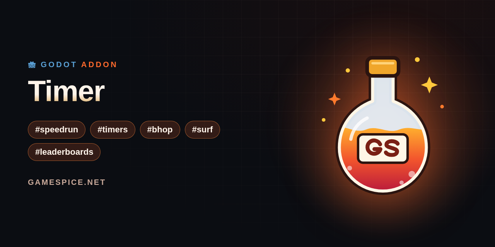

[](https://moddingcommunity.com/a/12-gs-timer)

Speedrun timers for Godot 4: bunny-hop, surf, KZ and anything else run against the clock. Zones a mapper draws, tracks and bonuses, stages and splits, styles, replays, records and leaderboards.

Time is counted in ticks with sub-tick zone crossings, so a run set on a 64 Hz server is comparable with one set on a 128 Hz server. That lets two servers share a records table. It works in 2D as well as 3D.

## Install

1. Get [Godot 4.7](https://godotengine.org/download).
2. Either use [GameSpice Bootstrap](https://github.com/gamespice-platform/bootstrap), which clones every project and links the addons, or copy `addons/dot_timer/` and [GameSpice Core](https://github.com/gamespice-platform/core)'s `addons/dot_core/` into your project and enable dot-timer in *Project > Project Settings > Plugins*.

Only GameSpice Core is required. [GameSpice Player Controller](https://github.com/gamespice-platform/player-controller), GameSpice Net and GameSpice Server are optional.

## Use

```gdscript
var manager := GSTimerManager.new()
manager.authoritative = true          # on the server. A client leaves this false.
manager.tick_rate = 128
manager.store = GSTimerStoreFile.at("user://records")   # or GSTimerStoreSql, below
add_child(manager)

manager.set_styles(GSTimerStyle.defaults())
manager.adopt_engine_tick_rate()      # on a server: whatever sv_tickrate says
manager.load_zones("res://maps/surf_beginner.zones.json")
manager.add_player(&"p1", "Christian")

manager.record_accepted.connect(
    func(record, previous, rank):
        print("%s, rank %d" % [record.formatted_time(), rank])
)
```

Then once per simulated tick, from your movement loop (not `_process`, or a player's time depends on their monitor):

```gdscript
manager.tick_player(
    &"p1", state.position, state.velocity, state.is_grounded(),
    alive, state.yaw, state.pitch
)
```

`run_filed` has everything a "you finished" message needs: the record, the previous best and record, whether it is a new record, the rank, the board's size, the points and the player's title.

## What it gives you

| Feature | Detail |
| --- | --- |
| Zones | Start, end, stage, checkpoint, teleport, respawn, slay, stop, speed limit, gravity, air acceleration, push, no-jump, auto-hop, freestyle, slide, and your own. Drawn in the editor or in game with two console commands. |
| Tracks | A main route and bonuses, each with its own zones, records and leaderboard. Bonuses are usually numbered 1..8; any number is accepted. |
| Styles | Sideways, half-sideways, backwards, low gravity, prebhop. Ranking weight and minimum time live here; the movement lives in GameSpice Player Controller. |
| Replays | Quantised and delta-encoded, played back by time so they run right on any monitor. |
| Records | In memory, JSON files, or SQLite, PostgreSQL and MySQL through [GameSpice SQL](https://github.com/gamespice-platform/sql). World record, top lists, ranks (ties share a place), completion counts, per-stage records. Reads are cached. |
| Rankings | Points per record from `curve`, `tiered` or `placement`, re-scored when a board's record changes, with rank titles you supply. |
| Players | Profile, attempts and time per map, and a dropped run kept for `resume_seconds` (default 600) so a player who disconnects can take it back. |
| Rules | Start speed caps, ground time before a start, every stage required, validator and checker zones, pause rules, runs stopped by no clip or unexplained teleports. |
| Practice | `+cp` / `+tp` checkpoints: saving is free, restoring costs you the run. |
| HUD | Clock, split, speedometer, strafe statistics, record and personal best, a `[P]` marker on practised runs, and `GSTimerSplitsPanel` for staged maps. No art or theme, so you style it. |
| Config | `GSTimerConfig` layers a file, the environment and the command line, and takes its tick rate from `sv_tickrate`. |

## Records in a database

```gdscript
var made := GSSql.from_config({"driver": "sqlite", "path": "user://records.db"}, self)
var store := GSTimerStoreSql.new(made.value)
var opened := await store.open()      # creates or migrates the tables
manager.store = store
```

For PostgreSQL or MySQL, point GameSpice SQL at its HTTP gateway. GameSpice SQL is only needed if you use this store.

The manager answers what chat commands ask: `profile`, `top_players`, `recent_records`, `maps_done`, `maps_left`, `section_records`, `suggest_time_limit`, `would_rank`, and for admins `set_map_tier`, `rescore_map`, plus the store's `wipe_player`, `wipe_board` and `remove`.

## Drawing zones without an editor

Walk to one corner, run a command, walk to the other, run it again:

```gdscript
var painter := GSTimerZonePainter.on(manager.zones)

painter.begin(GSTimerZone.Kind.START, GSTimerTrack.MAIN)
painter.mark(player_position)   # first corner
painter.mark(player_position)   # second corner, and the zone exists

manager.zones.save_json("user://zones/surf_beginner.json")
```

Height is added above the marked corners for you. For 2D, pass `Vector3(x, y, 0)` positions against zones authored with `GSTimerZoneVolume2D`.

## Testing

Import the project once, then run `timer_selftest.tscn`, `timer_2d_selftest.tscn` and `timer_records_selftest.tscn` in `examples/` headless with Godot. `../dot-sql/tools/test_live.sh . res://examples/timer_sql_live.tscn` runs the SQL store against real databases.

More in [docs/](docs/README.md): the design reasoning, what each refusal in `can_record` defends against, and [history](docs/history.md).

## Status and licence

Part of the [**GameSpice**](https://gamespice.net) platform: a family of Godot addons. Written with Claude Code and maintained by `gamemann`. Every addon has headless tests, but little of this has been played by real users yet, so expect rough edges and please [open an issue](https://github.com/gamespice-platform/timer/issues) when you hit one.

MIT licence, see [LICENSE](LICENSE). The only closed part of the [**GameSpice**](https://gamespice.net) platform is the web back end; you can use your own instead of GameSpice's.
